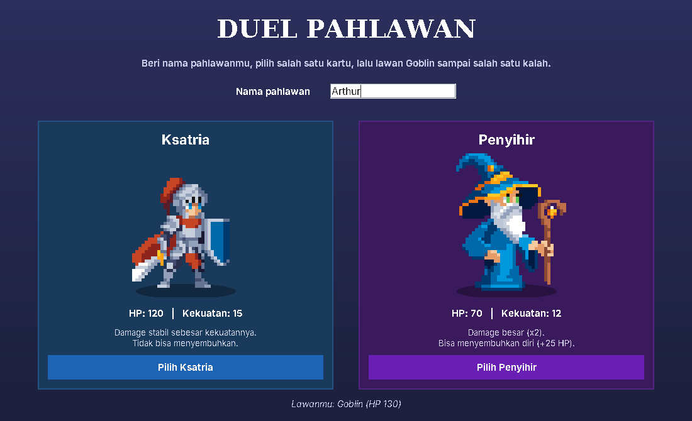
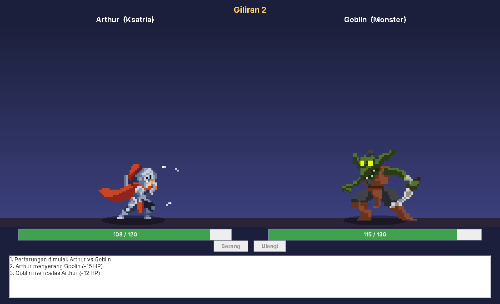
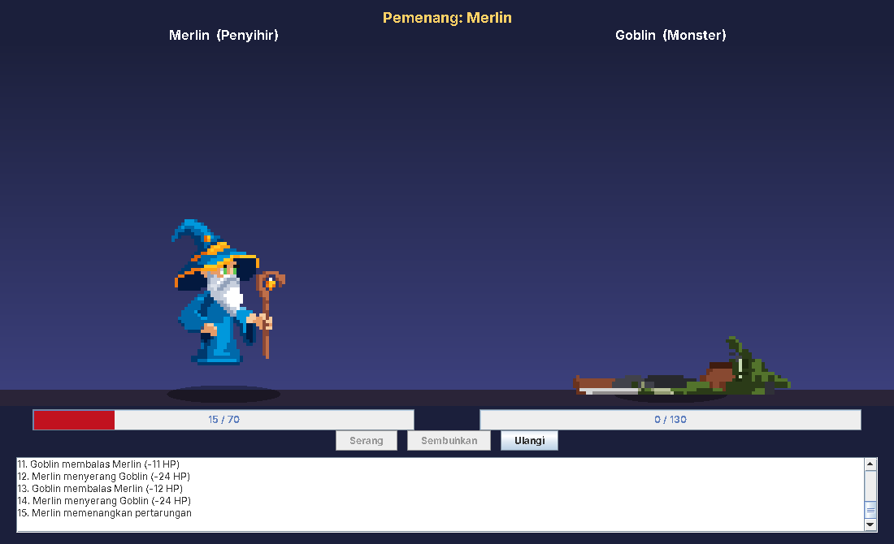

# Hero Duel

A turn-based hero battle game written in **Java** with a **Swing** GUI.
_(Indonesian title: **Duel Pahlawan**.)_

Pick a hero, then trade blows with a monster until one side runs out of HP. The project is built around clean object-oriented design: encapsulation, inheritance, polymorphism, abstraction, and exception handling.

## Gameplay

| Character | Role | HP | Power | Attack | Special |
|---|---|---|---|---|---|
| Knight (`Ksatria`) | Hero | 120 | 15 | Fixed damage (15) | n/a |
| Mage (`Penyihir`) | Hero | 70 | 12 | Double damage (24) | Heals itself for 25 HP (never above max HP) |
| Monster | Enemy (AI) | 130 | 16 | Random damage (8 to 16) | n/a |

Each turn the player attacks (or heals, as the Mage); the monster then strikes back automatically. Every event is written to a battle log, and the fight ends when either side reaches 0 HP.

## Architecture

```
Karakter (abstract)  <|--  Ksatria
        ^            <|--  Penyihir ..|> BisaMenyembuhkan (interface)
        |            <|--  Monster
Pertarungan  o--  2 x Karakter   (aggregation: hero + enemy)
```

- **Encapsulation:** `Karakter` keeps `hp` private; it only changes through validated `terimaDamage()` / `pulihkanHp()`.
- **Abstraction:** `Karakter` is abstract with an abstract `serang()`; `BisaMenyembuhkan` models the optional healing ability.
- **Inheritance and overriding:** each subclass defines its own attack.
- **Polymorphism:** `Pertarungan` works with `Karakter` references; the right `serang()` runs at runtime, so new character types need no changes to the battle logic.
- **Exception handling:** a checked `KarakterMatiException` for actions on a defeated character.
- **Separation of concerns:** `model` (game logic, no Swing imports) vs `ui` (Swing).

> Class and method names are in Indonesian (`Karakter` = Character, `serang` = attack, `sembuhkan` = heal, `Pertarungan` = Battle).

## Project structure

```
src/duelpahlawan/
  model/    game logic (Karakter, Ksatria, Penyihir, Monster, Pertarungan, ...)
  ui/       Swing user interface: Main, JendelaUtama, PanelKarakter,
            AnimasiSprite, AksiSprite, and sprite/ (pixel-art sprite sheets)
uji/        console test runner for the model (UjiCoba.java)
docs/
  diagram/     PlantUML sources: use case, class, sequence, object diagrams
  screenshot/  screenshots of the running game
  erd-duel-pahlawan.drawio   conceptual ER diagram (open in draw.io)
```

## Getting started (JDK 17+)

Windows: double-click `jalankan.bat` (it compiles and starts the game). It needs a JDK on your PATH (`winget install EclipseAdoptium.Temurin.21.JDK`, then reopen the terminal).

Run the game from a terminal (in the project folder):

```bash
javac -d out -sourcepath src src/duelpahlawan/ui/Main.java
cp -r src/duelpahlawan/ui/sprite out/duelpahlawan/ui/   # sprites next to the compiled classes
java -cp out duelpahlawan.ui.Main
```

If the sprites are not on the classpath, the game falls back to `src/duelpahlawan/ui/sprite/` relative to the working directory, so running `Main` from an editor with the project folder as working directory also works.

Run the model tests:

```bash
javac -d out -cp out uji/UjiCoba.java
java -cp out UjiCoba
```

Windows PowerShell:

```powershell
javac -d out -sourcepath src src/duelpahlawan/ui/Main.java
Copy-Item -Recurse src/duelpahlawan/ui/sprite out/duelpahlawan/ui/
java -cp out duelpahlawan.ui.Main
```

IDEs (IntelliJ, Eclipse, NetBeans) copy resources under `src/` automatically; just run `duelpahlawan.ui.Main`. In VS Code, install the "Extension Pack for Java", open the project folder, and run `Main.java`.

## Animation

Each character has pixel-art sprite sheets (horizontal strips of frames): idle, attack, hurt, death, plus heal for the Mage and a victory hop. The GUI only plays them; all battle rules stay in `model`. The Knight and Monster step toward the opponent when attacking, while the Mage casts from a distance.

## Screenshots

| Choose a hero | Battle | Result |
|---|---|---|
|  |  |  |

## Roadmap

- [x] Game model + tests
- [x] UML diagrams and ER diagram
- [x] Swing GUI with sprite animation (`ui/JendelaUtama`, `Main`)
- [x] Screenshots
- [ ] Sync class and sequence diagrams with the `ui` classes
- [ ] Project report

## Contributing

1. Do not commit directly to `main`; create a branch per task (`feature/short-name`).
2. Keep commits small with clear messages, then open a Pull Request and ask for one review.
3. Keep class, attribute, and method names aligned with the diagrams in `docs/diagram`; update the diagrams if you rename anything.
4. Build output and IDE files are ignored via `.gitignore`.

## Contributors

[Devin Rafa Haryanto](https://github.com/DevinRafa), Najmi, Willy, Fardizza, Rafi
